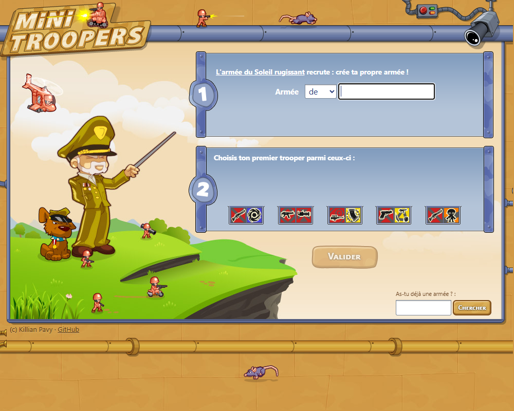

# MiniTroopers — remake

Recréation fidèle de **MiniTroopers** (Motion-Twin, 2011–2023) : serveur léger en TypeScript,
pages identiques à l'original, et un moteur de combat **prouvé identique** au SWF d'origine.



Les fichiers du jeu (`assets/swf/`) sont © Motion-Twin. Voir [LICENSE](LICENSE) et [NOTICE](NOTICE).

## Pourquoi ce projet

Le remake public d'Eternaltwin ([GitLab](https://gitlab.com/eternaltwin/minitroopers/minitroopers))
est inachevé : mission Epic absente, plusieurs règles divergentes de l'original, et son moteur
de combat tourne encore dans le SWF Flash via Ruffle. Le serveur de test d'Eternaltwin repose
sur un autre code, non publié.

Objectif ici : un joueur de l'original ne doit voir **aucune différence de gameplay** — mêmes
combats pour une même graine, mêmes règles, mêmes pages, même économie.

## Avancement

Les quatre étapes sont terminées. Le jeu complet tourne en production depuis le 2026-11-23 (`v1.0.0`).
Après `v1.0.0`, le projet ajoute des améliorations au-delà de l'original ; la première est le lecteur de combats amélioré.

| Étape | Contenu | État |
|---|---|---|
| 1 | Banc différentiel + moteur de combat exact | ✅ `@mt/engine` 1.0.0, 0 écart sur 10 000 combats oracle |
| 2 | Règles de jeu, serveur, création d'armée, HQ, recrutement, amélioration, combats quotidiens | ✅ |
| 3 | Missions (Extermination, Infiltration, Epic), raids, parrainage, protection par mot de passe | ✅ |
| 4 | Historique, classements, ordre de déploiement, fin de journée, image Docker, CLI d'administration | ✅ |

Ajouts depuis la fin de l'étape 4 :

- infobulles des 141 compétences et armes, tirées du texte de `client_fr.swf` (#2) ;
- `reset-day` tire à nouveau la boutique `/add` et les adversaires `/b/opp` du jour (#3) ;
- `set-faction` change la couleur d'uniforme d'une armée (#4) ;
- lecteur de combats amélioré sur toutes les pages de combat (voir [Lecteur de combats amélioré](#lecteur-de-combats-amélioré)) ;
- Ruffle utilise le rendu WebGL : animations fluides sur les GPU où le rendu par défaut (wgpu) rame (#5).

## Fonctionnalités

Toutes les fonctionnalités joueur de l'original sont présentes, avec les mêmes URLs et les mêmes pages.

**Armée et compte**
- Création d'une armée : un nom et 1 trooper à choisir parmi 5 offres du jour. Le nombre de créations par IP et par jour est limité.
- Mode sous-domaine (`<armée>.domaine/hq`) ou mode chemin (`/a/<armée>/hq`) quand il n'y a pas de DNS wildcard.
- `/protect` : mot de passe d'armée.
- 6 armées de faction (bots) créées au premier démarrage. Une recrue hérite de la couleur de son recruteur.

**Pages**
- `/hq` : crédits, puissance, troopers, combats, mission, raid et recrutement.
- `/t/<n>` : fiche d'un trooper. Elle permet :
  - d'améliorer le trooper ;
  - de choisir une compétence à la montée de niveau (2 choix, 3 avec Malin ; spécialisation au niveau 6) ;
  - de le renommer une seule fois ;
  - de le rééquiper s'il porte plus de 3 objets ;
  - de régler ses préférences d'IA, débloquées selon le niveau.
- `/add` : achat d'un trooper au coût de la table originale (8, 24, 60… 2000), 12 troopers au maximum.
- `/b/opp` : environ 5 adversaires de puissance proche, plus l'attaque d'une armée par son nom.
- `/history` : les 10 dernières défenses, les recrues et leur animation, et la confirmation des primes de parrainage.
- `/ranks` : classement des armées du même recruteur.
- `/choice` : ordre de déploiement, à partir de 5 troopers.
- `/endDay` : « C'est tout pour aujourd'hui », avec compte à rebours.
- Rediffusion des combats (`/b/view/…`, `/b/fview/<id>`) par le SWF original sous Ruffle auto-hébergé.

**Modes de jeu et économie**
- Combats quotidiens : 3 par jour, +1 par trooper Commandement, 5 au maximum. Un combat gagné rapporte 2 crédits, un combat perdu 1.
- Missions :
  - déblocage pour 5 crédits ;
  - un type tiré au hasard chaque jour, 3 essais ;
  - 4 crédits par mission gagnée.
- Les trois types de mission :
  - Extermination : le nombre de rats augmente à chaque victoire ;
  - Infiltration ;
  - Epic : dès 10 recrues.
- Raids : les recrues enchaînent les phases et les survivants continuent. Chaque phase gagnée rapporte 4 crédits.
- Parrainage : 100, puis 50×3, 10×10, 5×20.
- Remise à zéro quotidienne à minuit, dans le fuseau configurable `TZ_GAME`.

**Exploitation**
- Image Docker `ghcr.io/kipavy/minitroopers` publiée par la CI (amd64/arm64), Docker Compose, `HEALTHCHECK` sur `/healthz`, arrêt propre.
- Fonctionne derrière Cloudflare Tunnel : avec `TRUST_PROXY=1`, l'IP du client est lue dans `CF-Connecting-IP`.
- CLI d'administration (`npm run admin`), voir [apps/server/README.md#administration](apps/server/README.md#administration) :
  - créer, afficher, renommer ou supprimer une armée ;
  - poser un mot de passe, gérer les crédits et la faction ;
  - fixer le nombre de rats, débloquer les missions ;
  - offrir une montée de niveau ;
  - rendre les quotas d'une journée ;
  - confirmer les recrues ;
  - sauvegarder la base pendant que le serveur tourne ;
  - créer l'« armée du frère » (`create-bro-army` : 12 troopers Malin, extermination avancée).

**Hors périmètre** (comme dans l'original, ou volontairement) : pas de chat, d'amis, de premium, de trophées,
de connexion Twinoid/Eternaltwin. Les fonctions payantes de l'original sont gratuites ou désactivées.
Les bâtiments, territoires et événements n'ont pas été repris : ils avaient été abandonnés dans l'original et
les archives n'en gardent aucune trace.

### Lecteur de combats amélioré

Actif par défaut sur toutes les pages de combat. Son interface reprend celle de BetterTrooper, avec l'accord de son
développeur (voir Crédits). Il est intégré nativement : pas d'extension de navigateur.

- **Chargement progressif** : le combat commence à se jouer dès sa première entrée, pendant que le jeu calcule la
  suite. Un voile en trois étapes couvre le chargement ; la partie de la frise pas encore calculée est hachurée
  (« simulation NN % ») et le journal attend la fin du calcul.
- **Sauts instantanés**, dans les deux sens : le jeu garde des images clés du combat et repart de la plus proche,
  sans recharger le lecteur. Un saut au-delà de la partie calculée attend le calcul sous un voile.
- **Pause native** : le bouton, `K` ou un clic sur le terrain ouvrent l'écran de pause du jeu (terrain grisé,
  « PAUSE », fiche d'un trooper au clic). Les sauts gardent la pause.
- **Transport** : pas de −50, −10, −5, −1, +1, +5, +10 et +50 événements ; maintenus, ils se répètent.
- **Frise des vagues** : un clic va au début de la vague ; glisser ou Maj+clic va à l'événement exact.
- **Vitesse** de ×1/16 à ×32 en 19 crans, bouton ×2 / ×1, `+` maintenu pour ×2.
- **Journal du combat** en français, façon BetterTrooper : horloge, têtes et couleurs des armées, icônes du jeu
  (armes, équipement, compétences), état des réserves ; il suit le combat, un clic sur une ligne y saute.
- **Partage** : choix du départ (début, vague, événement), message prêt pour Discord, lien `?at=<événement>`.
- **Capture d'écran** : le jeu seul ou encadré (titre, date, frise, lien), à télécharger ou copier.
- **Sons réalistes** (le jeu original est muet) : tirs selon la famille d'arme, impacts, coups critiques, morts,
  grenades (goupille, lancer, détonation propre à chaque type : flash, gaz, gluante, trou noir…), explosions,
  véhicules (moteurs de moto, jeep, chars, hélicoptère ; avion de chasse), pas de course, roulades, chutes, objets
  (Twinoïde, talkie-walkie, piqûres, soins), rats, rechargement, déploiement, victoire ou défaite, joués à l'image exacte de l'action et placés à
  gauche ou à droite selon le trooper. Silence pendant un saut, en pause, sous une fenêtre ou onglet caché ; à grande
  vitesse, les sons se raréfient au lieu de saturer. Bouton son du lecteur (actif par défaut, choix mémorisé).
- Ligne d'état (événement, vague, images par seconde), avertissement quand un combat reste bloqué.
- **Mobile** : quatre pas autour de la pause sous 720 px ; en paysage, scène sur toute la hauteur, commandes à
  droite et plein écran au premier toucher.
- Raccourcis (`?` affiche la liste) :

| Touche | Action |
|---|---|
| `K` ou Maj+Espace | pause / reprise |
| Espace ou `N` | vague suivante |
| `←` / `→` (Maj : ×10) | un événement en arrière / en avant |
| PgHaut ou `P` | début de la vague (deux fois vite : la précédente) |
| `Début` / `Fin` ou `H` / `E` | début / fin du combat |
| `<` / `>` (ou `[` / `]`) | vitesse : un cran |
| `+` maintenu | ×2 tant que la touche est enfoncée |
| `S` | partager |
| `C` | capture d'écran |
| Ctrl+`/` ou `?` | cette liste |

Le lecteur modifie la boucle d'affichage de `client_fr_play.swf`, jamais le calcul du combat : le résultat reste
identique à l'original, entrée pour entrée, ce que vérifie le banc oracle. `v1.0.0` (et l'image
`ghcr.io/kipavy/minitroopers:1.0.0`) garde le lecteur d'origine. Détails :
[conception](docs/superpowers/specs/2026-11-24-lecteur-ameliore-design.md),
[sauts instantanés](docs/superpowers/specs/2026-11-25-sauts-instantanes-design.md),
[recherche sur le SWF](docs/research/lecteur-swf.md).

### Aperçus de liens

Le lien public d'un combat quotidien (`/b/fview/<id>`, celui de `/history`) collé dans Discord, WhatsApp, etc.
s'affiche avec un aperçu (balises Open Graph et Twitter) : titre « Revoir : L'armée de X VS L'armée de Y », date
et vainqueur du combat, et une bannière propre au combat (`/og/battle/<id>.jpg`, 1200×630) : le décor du
combat, le logo, les noms des deux armées aux couleurs de leur faction autour d'un « VS », leurs effectifs, la date
et le numéro du combat. Elle est dessinée en SVG puis rastérisée par [resvg](https://github.com/thx/resvg-js)
(police Lilita One, `apps/server/fonts/`) sur un thread à part, une seule fois par combat, puis servie depuis
`DATA_DIR/og/` (`apps/server/scripts/og-samples.ts <dossier>` produit des exemples). Les missions et les raids
n'ont pas de page publique, donc pas d'aperçu.

### Règles non vérifiables

Le moteur de combat est prouvé identique au SWF. En revanche, certaines règles ne s'exécutaient que sur le
serveur Motion-Twin : génération des offres, choix des adversaires, rééquipement, plafond de raid… Quand
aucune source ne les fixe, la valeur choisie porte un commentaire `// UNVERIFIED` dans le code. Elle est listée,
avec sa raison, dans [docs/game/unverified.md](docs/game/unverified.md).

## Comment on garantit la fidélité

Le SWF original calcule tout le combat d'avance (tableau `history`) avant de l'animer.
On s'en sert comme **oracle** :

```
                 ┌──────────────────────────────┐
  corpus de      │  client_fr.swf instrumenté   │──► trace golden (TRP / EV / END)
  combats   ───► │  (Ruffle, headless)          │                │
  aléatoires     └──────────────────────────────┘                ▼
       │                                                    oracle:diff ──► premier écart
       │         ┌──────────────────────────────┐                ▲
       └───────► │  @mt/engine (TypeScript pur) │──► trace ──────┘
                 └──────────────────────────────┘
```

1. Le SWF d'origine (`client_fr.swf`) est instrumenté pour imprimer les troopers générés et
   chaque événement du combat, sans toucher à sa logique.
2. Des milliers de combats aléatoires (toutes compétences, armes, véhicules, rats, armées
   de 1 à 32) passent dans le SWF : leurs traces deviennent des fichiers **golden**.
3. Le moteur TypeScript est porté depuis la décompilation, module par module, jusqu'à
   **zéro écart sur 10 000 combats**.
4. Les golden sont committés : la CI vérifie le moteur sans Flash ni Ruffle.

## Structure

```
packages/engine   moteur de combat déterministe, zéro dépendance
packages/game     règles hors combat : coûts, génération, offres, missions, raids, parrainage
apps/server       serveur Hono + SQLite, pages rendues côté serveur, CLI d'administration
tools/oracle      banc différentiel : instrumentation SWF, runner Ruffle, corpus, diff
assets/swf        SWF originaux (© Motion-Twin) + SHA256SUMS
docs/             conception, plans, référence du jeu original
```

## Démarrer

Prérequis : **Node 24.12+**.

```sh
npm ci
npm test          # tests unitaires + rejeu des golden
npm run typecheck
```

### Jouer en local

```sh
npm run dev                                  # http://localhost:8080/ (mode chemin), données dans var/
npm run admin -- list                        # administration : voir apps/server/README.md#administration
URL_MODE=subdomain BASE_DOMAIN=mt.localhost npm run dev   # mode sous-domaines : http://mt.localhost:8080/
```

Au premier démarrage, les armées de faction sont créées. Configuration et test de bout en bout :
[apps/server/README.md](apps/server/README.md).

### Héberger son instance

Image Docker publiée par la CI sur `ghcr.io/kipavy/minitroopers` (amd64/arm64), Docker Compose derrière Cloudflare Tunnel, sauvegardes, mise à jour :
[deploy/README.md](deploy/README.md).

Le banc différentiel (`tools/oracle`) demande en plus Java 21 et JPEXS FFDec (instrumentation
du SWF), ainsi que Chromium via Playwright ou `ruffle_desktop` (exécution). Ces outils ne servent
qu'en développement : la procédure est décrite dans `tools/oracle/instrument/README.md`.

## Documentation

- [Conception](docs/superpowers/specs/2026-11-22-minitroopers-remake-design.md) : objectifs,
  choix d'architecture, checklist des fonctionnalités de l'original
- [Référence du jeu original](docs/research/original-game.md) : 140 compétences, 30 armes,
  véhicules, économie, modes de jeu, mécaniques de combat (wikis + archives)
- [Règles non vérifiables](docs/game/unverified.md) : valeurs choisies faute de source, avec leur raison
- Lecteur de combats amélioré : [conception](docs/superpowers/specs/2026-11-24-lecteur-ameliore-design.md),
  [plan](docs/superpowers/plans/2026-11-24-lecteur-ameliore.md),
  [recherche sur le SWF](docs/research/lecteur-swf.md)
- Plans : [étape 1](docs/superpowers/plans/2026-11-22-etape1-banc-et-moteur.md),
  [étape 2](docs/superpowers/plans/2026-11-22-etape2-serveur-armee-combats.md),
  [étape 3](docs/superpowers/plans/2026-11-23-etape3-missions-raids-parrainage.md),
  [étape 4](docs/superpowers/plans/2026-11-23-etape4-historique-classements-docker.md)
- [Hébergement Docker](deploy/README.md) et [serveur et administration](apps/server/README.md)

## Crédits

- **Motion-Twin** — jeu original et tous ses assets.
- **Eternaltwin / YesLifeTechnology** — remake GitLab (MIT), dont ce projet reprend le
  sérialiseur Haxe, des règles de jeu et la table de désobfuscation.
- **Ruffle** et **JPEXS FFDec** — exécution et décompilation des SWF.
- **BetterTrooper** ([bettertrooper.milvintsiss.com](https://bettertrooper.milvintsiss.com))
- Wikis communautaires : MiniTroopers Fandom (EN) et Twinpedia (FR).
- **Sons des combats** (`apps/server/public/sfx/`) : enregistrements de [Freesound](https://freesound.org), tous
  sous licence [CC0](https://creativecommons.org/publicdomain/zero/1.0/) (domaine public), découpés, mixés et
  normalisés pour le jeu (correspondance action → son en tête de `apps/server/public/js/sfx.js`) :

| Fichier | Son d'origine | Auteur | Lien |
|---|---|---|---|
| pistol, pistol-dual | Pistol Shot | LeMudCrab | [freesound.org/s/163456](https://freesound.org/s/163456/) |
| pistol-heavy | Desert Eagle Gunshot | elliotlp | [freesound.org/s/330634](https://freesound.org/s/330634/) |
| rifle, rifle-double | Rifle Gun Shot 01.wav | LilMati | [freesound.org/s/433858](https://freesound.org/s/433858/) |
| rifle-auto | An automatic rifle being shot once // punchy sounding | serøutōnin--deprivəd | [freesound.org/s/855654](https://freesound.org/s/855654/) |
| shotgun, shotgun-dry | shotgun shoot | MrGungus | [freesound.org/s/773873](https://freesound.org/s/773873/) |
| shotgun | SXP_SHOTGUN_RACK_01 | dasBUTCHER84 | [freesound.org/s/449614](https://freesound.org/s/449614/) |
| assault | AK47 Shot | LeMudCrab | [freesound.org/s/163457](https://freesound.org/s/163457/) |
| mg | Minigun Fire | Bratish | [freesound.org/s/500304](https://freesound.org/s/500304/) |
| rocket | Rocket Launch | Jarusca | [freesound.org/s/521377](https://freesound.org/s/521377/) |
| sniper | Sniper Shot in Field 3 (M2010 Enhanced Sniper Rifle ESR) | qubodup | [freesound.org/s/855608](https://freesound.org/s/855608/) |
| cannon | Tank fire Mixed.wav | GaryQ | [freesound.org/s/127845](https://freesound.org/s/127845/) |
| knife | Large Swede Stab with Whoosh.wav | minituffy | [freesound.org/s/385966](https://freesound.org/s/385966/) |
| punch | body_hit.wav | insanity54 | [freesound.org/s/276600](https://freesound.org/s/276600/) |
| throw | ThrowGrenadeCloth.ogg | Avreliy | [freesound.org/s/611613](https://freesound.org/s/611613/) |
| explosion | explosion13.wav | V-ktor | [freesound.org/s/435416](https://freesound.org/s/435416/) |
| explosion-big | Gun / Cannon / Explosion | SamsterBirdies | [freesound.org/s/580040](https://freesound.org/s/580040/) |
| reload | Handgun_Reload.wav | ken788 | [freesound.org/s/386744](https://freesound.org/s/386744/) |
| hit | VisceralBulletImpacts.wav | u1769092 | [freesound.org/s/423301](https://freesound.org/s/423301/) |
| crit | Headshot.wav | Pablobd | [freesound.org/s/511194](https://freesound.org/s/511194/) |
| miss | Real Bullet Flyby Sound | qubodup | [freesound.org/s/855248](https://freesound.org/s/855248/) |
| death | Grunt1 - Death Pain.wav | tonsil5 | [freesound.org/s/416839](https://freesound.org/s/416839/) |
| death-2 | Male Death Sound | Blankened | [freesound.org/s/554443](https://freesound.org/s/554443/) |
| deploy | Walkie Talkie Beep | SoundBiterSFX | [freesound.org/s/732209](https://freesound.org/s/732209/) |
| deploy | Heavy Walking.wav | morganpurkis | [freesound.org/s/381570](https://freesound.org/s/381570/) |
| victory | Fanfare - Rpg | colorsCrimsonTears | [freesound.org/s/566203](https://freesound.org/s/566203/) |
| defeat | End Game - Fail | davidbain | [freesound.org/s/135831](https://freesound.org/s/135831/) |
| clown | partypopper.flac | Streety | [freesound.org/s/26349](https://freesound.org/s/26349/) |
| blackhole | oddworld_ReverseBang.wav | Oddworld | [freesound.org/s/75329](https://freesound.org/s/75329/) |
| shock | Shockwave.mp3 | TristanLuigi | [freesound.org/s/110819](https://freesound.org/s/110819/) |
| bigtank | tracked vehicle.wav | cognito perceptu | [freesound.org/s/121531](https://freesound.org/s/121531/) |
| ratbite | ratSqueak.wav | Zabuhailo | [freesound.org/s/143125](https://freesound.org/s/143125/) |
| ratrun | rat gnawing a rusk.wav | Zabuhailo | [freesound.org/s/143250](https://freesound.org/s/143250/) |
| pin | ring pull flick 2.wav | lolamadeus | [freesound.org/s/144182](https://freesound.org/s/144182/) |
| tank | Driving Tank Engine.flac | qubodup | [freesound.org/s/187676](https://freesound.org/s/187676/) |
| flash | Ear Ring.wav | ErikH2000 | [freesound.org/s/232212](https://freesound.org/s/232212/) |
| clown, clownhit | Clown_Horn.mp3 | inplay | [freesound.org/s/251611](https://freesound.org/s/251611/) |
| healgren | Aerosol Spray | WeeJee_vdH | [freesound.org/s/267709](https://freesound.org/s/267709/) |
| whoosh | Knife Swish 1.wav | jawbutch | [freesound.org/s/344403](https://freesound.org/s/344403/) |
| fly | Whoosh_1.wav | lzmraul | [freesound.org/s/389458](https://freesound.org/s/389458/) |
| ricochet | Ricochet 2.wav | morganpurkis | [freesound.org/s/392975](https://freesound.org/s/392975/) |
| roll, fall-2 | Body falling on the ground 1 | ihitokage | [freesound.org/s/395331](https://freesound.org/s/395331/) |
| pin | Little Metal Piece Drop 3 | Timmeh515 | [freesound.org/s/413301](https://freesound.org/s/413301/) |
| sticky | Mud Splat | Breviceps | [freesound.org/s/445109](https://freesound.org/s/445109/) |
| sticky | Step on a slug (Splat!) 1 | Breviceps | [freesound.org/s/447929](https://freesound.org/s/447929/) |
| carry | R18-35-Drag Body Across Floor.wav | craigsmith | [freesound.org/s/481863](https://freesound.org/s/481863/) |
| fall | BODY FALL - V HVY - DIRT | leonelmail | [freesound.org/s/504626](https://freesound.org/s/504626/) |
| radio | Radio Sign Off / Squelch | JovianSounds | [freesound.org/s/524205](https://freesound.org/s/524205/) |
| pill | Pill Bottle Quick Shaking out Pills | Rudmer_Rotteveel | [freesound.org/s/536419](https://freesound.org/s/536419/) |
| gas | Gas Grenade.wav | Themiwa100 | [freesound.org/s/551429](https://freesound.org/s/551429/) |
| jet | High speed pass | US Navy FA/18 Super Hornet fighter jets by PostProdDog | [freesound.org/s/581097](https://freesound.org/s/581097/) |
| blessed | bell ding 1.wav | 5ro4 | [freesound.org/s/611113](https://freesound.org/s/611113/) |
| clownlaugh | Man's laugh | quavosh | [freesound.org/s/670839](https://freesound.org/s/670839/) |
| switch | 22lr revolver handling clicking foley | serøutōnin--deprivəd | [freesound.org/s/677159](https://freesound.org/s/677159/) |
| pill | Gulp, single swallow.mp3 | UnderASpell | [freesound.org/s/693249](https://freesound.org/s/693249/) |
| empty | A rifle being dry fired once | serøutōnin--deprivəd | [freesound.org/s/725402](https://freesound.org/s/725402/) |
| flash | Flashbang | modusmogulus | [freesound.org/s/737326](https://freesound.org/s/737326/) |
| moto | Motorcycle - Harley Davidson vintage | Vrymaa | [freesound.org/s/737775](https://freesound.org/s/737775/) |
| magout | Mag_Out_2 | SuHomunRiko | [freesound.org/s/738334](https://freesound.org/s/738334/) |
| syringe | Syringe Pop | Chaos-Kid | [freesound.org/s/740045](https://freesound.org/s/740045/) |
| voodoo | SingleKnock_Wood | NoisyRedFox | [freesound.org/s/742356](https://freesound.org/s/742356/) |
| frag | Explosion And Schrapnel Fly-by | modusmogulus | [freesound.org/s/752630](https://freesound.org/s/752630/) |
| ratpain-2 | Rodent Sound | Tony_Cannoli | [freesound.org/s/798054](https://freesound.org/s/798054/) |
| ratpain | Mouse Rodent Squeak Whistle | SecureSubset | [freesound.org/s/800274](https://freesound.org/s/800274/) |
| heal | Tape Bandages Rip | SecureSubset | [freesound.org/s/800275](https://freesound.org/s/800275/) |
| ratdeath | Rodents - American Guinea Pig, Squealing, Close Perspective | TheKingOfGeeks360 | [freesound.org/s/815837](https://freesound.org/s/815837/) |
| ratbite | Crunch | qubodup | [freesound.org/s/816237](https://freesound.org/s/816237/) |
| run | running on dirt 2 edit | Luisa_Sanchez | [freesound.org/s/816792](https://freesound.org/s/816792/) |
| land | Human jumping down to gravel w/ impact | DeqstersLab | [freesound.org/s/819656](https://freesound.org/s/819656/) |
| jeep | Humvee driving on dirt road | barryshamir | [freesound.org/s/834241](https://freesound.org/s/834241/) |
| clang | Basic Metal Clang Free | AardsReal | [freesound.org/s/842171](https://freesound.org/s/842171/) |
| radio | Unintelligible Military Radio Voice Command | qubodup | [freesound.org/s/854482](https://freesound.org/s/854482/) |
| heli | UH‑60 Black Hawk Helicopter Hover Loop 1 | qubodup | [freesound.org/s/854493](https://freesound.org/s/854493/) |
| roll | Person Rolling on Floor Clothing Rustle | KoimeMatsuchiya | [freesound.org/s/872226](https://freesound.org/s/872226/) |

